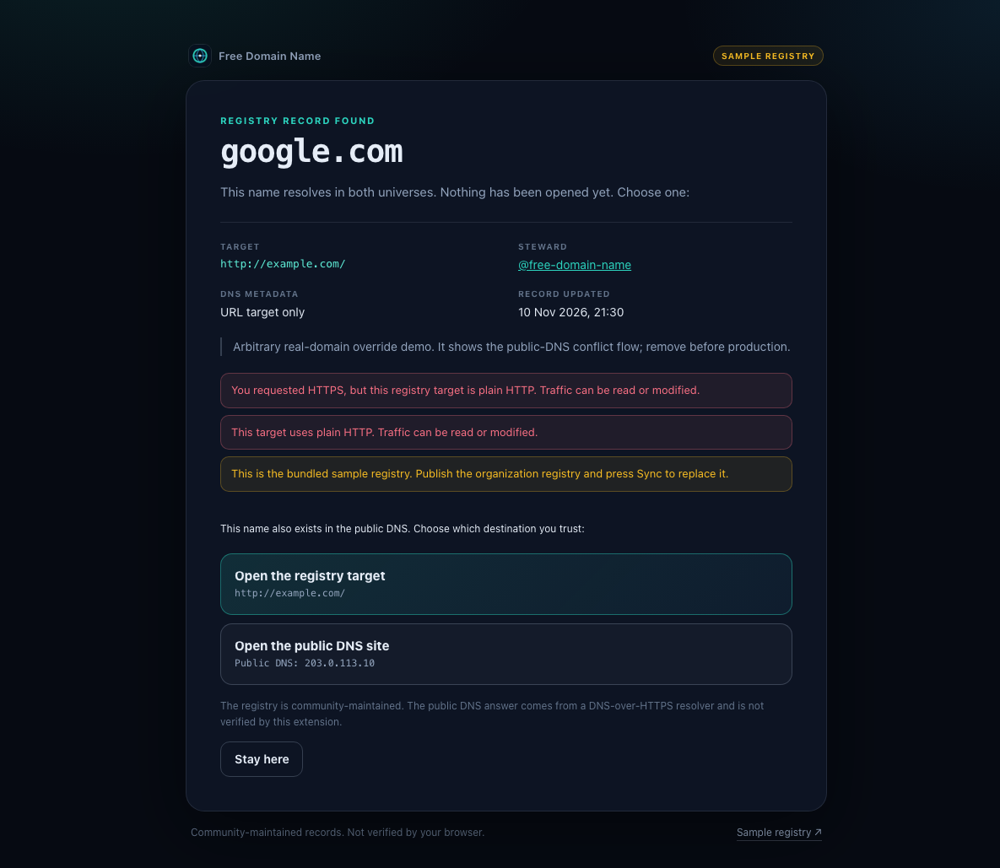
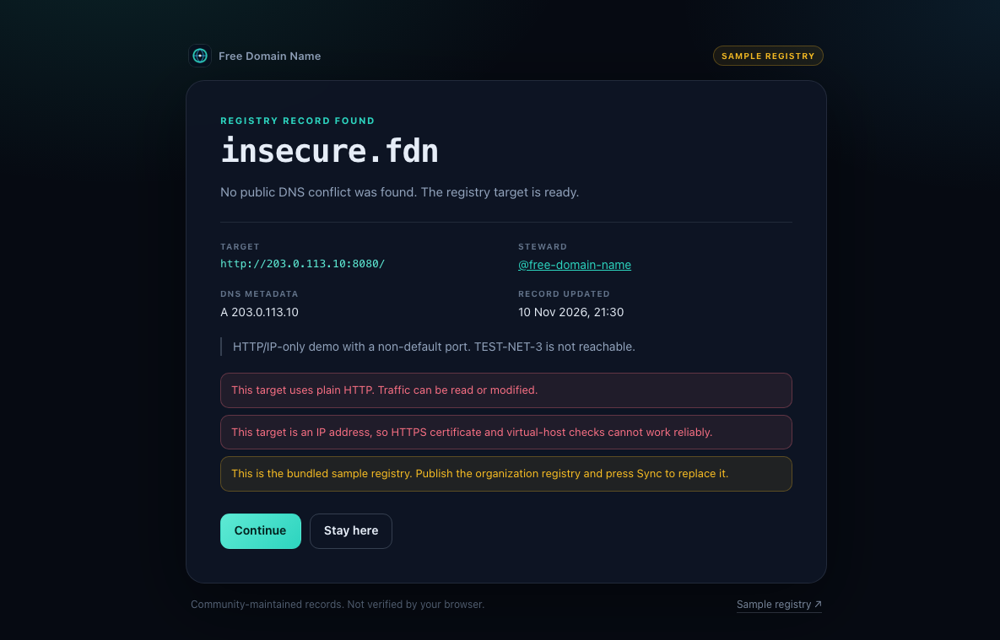
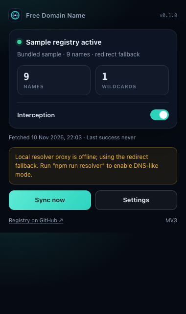
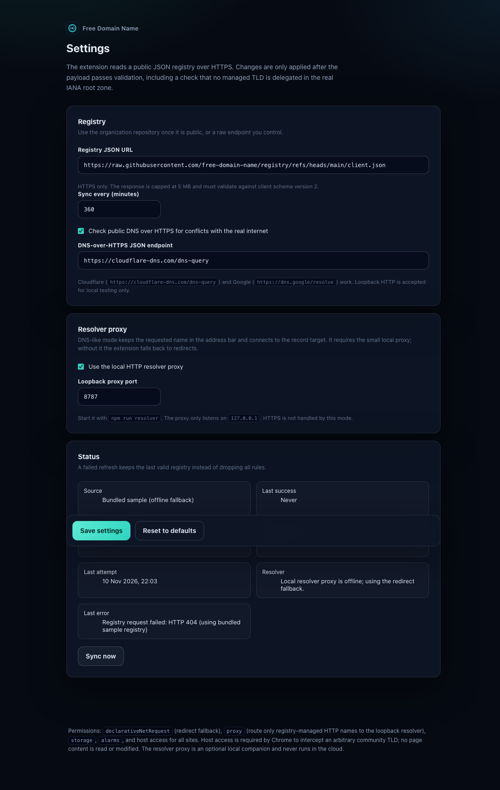

# Free Domain Name Resolver

A Chrome and Firefox Manifest V3 extension that resolves names from a community
GitHub registry. It is a **resolver**, not a redirector: when a registry record
exists, the browser keeps the requested name in the address bar and the local
resolver proxy fetches the content from the record target.

The extension is GPL-3.0-only: distributed modifications must remain open source
under the same license.

> **Status: HTTP resolver.** The DNS-like path is implemented with a loopback proxy
> and is verified in Chrome and Firefox. HTTPS/TLS for overridden names is out of
> scope. Without the proxy running, the extension falls back to a clearly labelled
> redirect mode.

## How resolution works

```text
browser: http://abc.com/
  -> Chrome PAC / Firefox proxy.onRequest
  -> 127.0.0.1:8787 (local resolver proxy)
  -> registry lookup: abc.com -> 89.58.37.84:9094
  -> proxy connects to 89.58.37.84:9094
  -> Host: abc.com
  -> response returned under http://abc.com/
```

The URL and `Host` stay with the requested name for an IP target. A hostname target
is treated as a reverse-proxy target: the proxy resolves it through public DNS and
uses that target host in `Host`, while the browser URL remains the registry name.

| Registry target | Address bar | Upstream connection | Upstream `Host` |
| --- | --- | --- | --- |
| `http://89.58.37.84:9094/` | `abc.com` | `89.58.37.84:9094` | `abc.com` |
| `http://ipmap.vitrn.com/` | `ipmap.info` | public DNS → `ipmap.vitrn.com:80` | `ipmap.vitrn.com` |
| `a: ["1.1.1.1"]` | record name | `1.1.1.1:80` | record name |

The proxy rewrites upstream `Location` and `Set-Cookie` domains that point at the
target back to the original name. Other absolute links inside a page may still
point at the target.

## Quick start

Requirements: Node 22+, Chrome 121+, or Firefox 140+.

```bash
npm install
npm run build
npm run resolver        # keep this terminal open; listens on 127.0.0.1:8787
```

Load the **same `dist/` directory** in either browser:

- **Chrome:** `chrome://extensions` → Developer mode → **Load unpacked** → `dist/`.
- **Firefox:** `about:debugging#/runtime/this-firefox` → **Load Temporary Add-on**
  → `dist/manifest.json`.

The extension checks `http://127.0.0.1:8787/__health` during sync and settings
changes. When the proxy answers, it installs the PAC/`proxy.onRequest` route and
clears the redirect rules. When it does not, it keeps the fallback.

Use **Settings → Sync now** after starting or stopping the proxy.

## Examples

```text
http://abc.com/      -> resolver: 89.58.37.84:9094, URL stays abc.com
http://ipmap.info/   -> resolver: http://ipmap.vitrn.com/, URL stays ipmap.info
http://abc.fdn/      -> resolver: 203.0.113.10:80
http://xyz.fdn/      -> resolver: 203.0.113.10:8080
http://google.com/   -> override target; resolver mode has no conflict screen
```

`abc.com` is in the public registry as requested. It points at
`http://89.58.37.84:9094/`; the proxy preserves `Host: abc.com`.

## Registry

- Registry: <https://github.com/free-domain-name/registry>
- Client index:
  <https://raw.githubusercontent.com/free-domain-name/registry/refs/heads/main/client.json>
- Manifest: [registry/registry.json](registry/registry.json)
- Client sample: [registry/client.json](registry/client.json)
- Schema: [registry/schema.json](registry/schema.json)

### Sharded source, generated client

Records are one file per name. `client.json` is generated and never hand-edited:

```text
registry/
  registry.json                 # manifest: schema, layout, counts
  client.json                   # generated client index
  names/
    goo/gle/google.com.json
    hel/lof/hello.fdn.json
    doc/sfd/docs.fdn.json
    dem/ofd/_wildcard.demo.fdn.json
    ins/ecu/insecure.fdn.json
    abc/fdn/abc.fdn.json
    abc/com/abc.com.json
    xyz/fdn/xyz.fdn.json
    ipm/api/ipmap.info.json
```

The path is deterministic: remove dots, use the first 3 characters as the first
directory and the next 3 as the second. Wildcards use `_wildcard.<base>.json`.

A record:

```json
{
  "name": "abc.com",
  "url": "http://89.58.37.84:9094/",
  "owner": "ozkanpakdil",
  "description": "abc.com resolves to 89.58.37.84 on port 9094.",
  "updatedAt": "2026-11-10T21:55:00Z"
}
```

Fields:

| Field | Meaning |
| --- | --- |
| `name` | Exact hostname or one wildcard (`*.demo.fdn`). |
| `url` | HTTP target; port is preserved. |
| `cname` | Hostname target; the proxy resolves it through public DNS. |
| `a` / `aaaa` | Address metadata; first A is an HTTP fallback if no URL/CNAME. |
| `owner` | GitHub handle of the steward. |
| `description` | Optional, up to 280 characters. |
| `updatedAt` | Optional ISO date. |

### Collision and overwrite rules

- A name maps to exactly one deterministic path. Duplicate names and wrong paths
  fail `registry/scripts/validate.mjs` and CI.
- Two names may share an IP and port; only the name must be unique.
- Editing an existing record is a reviewed PR. Protect `main`, require review, and
  treat owner changes as security changes. There is no cryptographic owner lock yet.
- The generated client is capped at **2,000 records** for the extension. The sharded
  source is not capped by that number.

### Publish

Copy [registry/](registry/) to the root of `free-domain-name/registry`, commit, and
push. Registry CI runs the shard validator, client freshness check, and JSON Schema
validation.

## Fallback mode

If the local proxy is offline (or disabled in Settings), the extension uses the
original `declarativeNetRequest` path:

- one redirect rule per record;
- an interstitial shows the target and warnings;
- a real-domain conflict offers registry vs public DNS;
- the URL changes to the target.

The popup reports `Redirect fallback`. This mode is intentionally retained so the
extension still functions before the companion proxy is installed. It is not the
DNS-like behavior; the local proxy is.

## Boundaries

- **A browser extension cannot do this alone.** It cannot listen on a socket or
  answer DNS. The resolver requires the loopback proxy in [resolver/](resolver/).
- **HTTP only.** HTTPS requests do not enter the resolver. There is no custom-TLD
  TLS.
- **The proxy is local.** It binds to `127.0.0.1` and sees the HTTP requests it
  handles. Do not expose it on a LAN interface.
- **Hostname targets use the target `Host`.** This is what makes
  `ipmap.info → http://ipmap.vitrn.com/` fetch the target site while keeping the
  `ipmap.info` URL. IP/port targets keep the original `Host`.
- **Scale.** The proxy currently loads the generated client. A 5-billion-name
  deployment needs on-demand shard lookup in the proxy; the extension/PAC list is
  still bounded. The sharded source is ready for that next step.
- **No true TLS.** Normal HTTPS browsing is untouched; custom names are HTTP in v1.

## Tests

```bash
npm run check          # typecheck + 32 tests + build + shard/client validation
npm run test:e2e       # Chrome fallback/DNR suite
npm run resolver       # start the local resolver
npx web-ext@10.8.0 lint --source-dir dist --no-input
```

Chrome resolver verification (local target + local registry) confirmed:

- PAC installed only for `resolver.test`;
- DNR rules cleared;
- browser URL remained `http://resolver.test/hello?x=1`;
- target received `Host: resolver.test`.

Firefox verification with `ipmap.info` confirmed the URL stayed `ipmap.info` and the
body came from `ipmap.vitrn.com`. A direct proxy check against
`abc.com -> 89.58.37.84:9094` returned the target page with `Host: abc.com`.

## Permissions

| Permission | Why |
| --- | --- |
| `declarativeNetRequest` | Redirect fallback only. |
| `proxy` | Route registry-managed HTTP names to the loopback resolver. |
| `host_permissions: <all_urls>` | Host access for PAC/proxy configuration and registry/DoH fetches. |
| `storage` | Registry cache, settings, sync status, DoH cache. |
| `alarms` | Periodic sync and session-rule cleanup. |

## Security and privacy

- The registry is trusted input. A merged record can point a name at any target.
- The resolver proxy is local and has no authentication beyond loopback binding.
- It sees the HTTP requests it handles; it is not a cloud service and has no
  telemetry.
- DoH is used only by the fallback conflict UI, not by resolver mode.
- No content scripts, no remote code.
- GPL-3.0-only keeps distributed modifications open.

See [SECURITY.md](SECURITY.md), [docs/architecture.md](docs/architecture.md), and
[docs/privacy.md](docs/privacy.md).

## Screenshots

| | |
| --- | --- |
|  |  |
|  |  |
